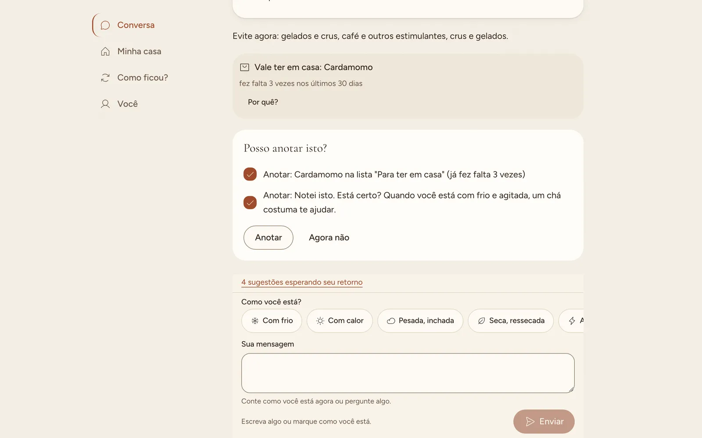
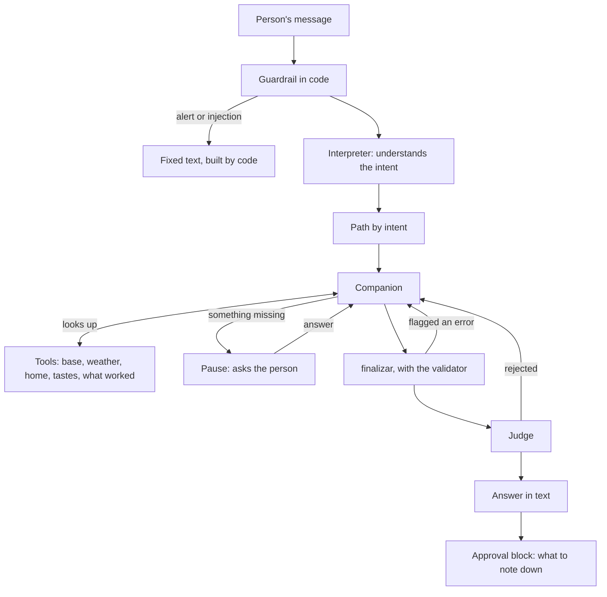
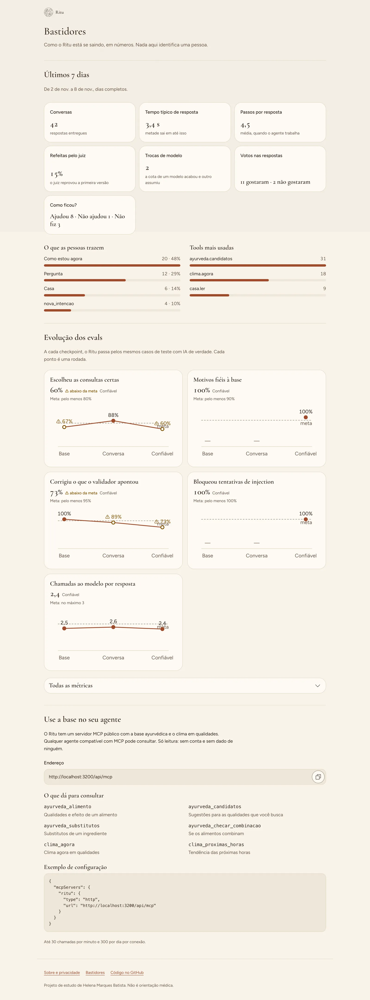
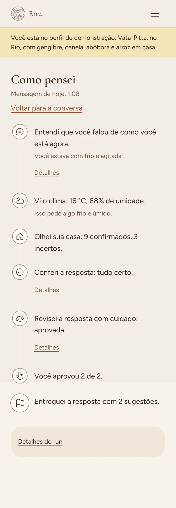
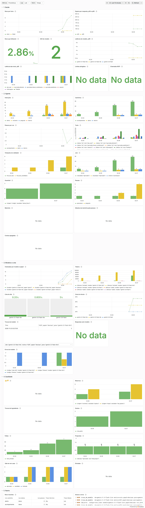

# Ritu

[Leia em português](README.md)

An everyday Ayurvedic agent: you say how you feel, in free text, and it answers with what to do right now, using what you have at home and the weather in your city.

<table>
  <tr>
    <td></td>
    <td></td>
  </tr>
</table>

<!-- ritu:site -->
Coming soon.
<!-- /ritu:site -->

## What it does

- Explains the reason behind each suggestion.
- Swaps an ingredient you don't have or don't like.
- Remembers what worked and what you don't eat.
- Tells you what is worth keeping at home for next time.
- Only notes something about you with your approval.

And it does not advise on illness, pregnancy or medication, does not use your device's location, does not send notifications and does not recommend brands, shops or prices.

## How it works inside



Memory comes in levels: the conversation, the home, tastes, what worked, what was missing, the routine and patterns, each with its own lifetime and its own way of reaching the agent, and all of it visible and editable for the person ([ADR 0012](.adrs/0012-memoria-em-niveis.md)). Each role has its own model, with an automatic switch when the quota runs out, and a Judge checks every answer written by the model before it reaches the person ([ADR 0014](.adrs/0014-modelos-por-papel.md), [ADR 0013](.adrs/0013-juiz-em-producao.md)). Reading is free and writing is proposed: the agent looks up what it needs, each message follows the path of its intent, and only the executor in code writes, after approval ([ADR 0008](.adrs/0008-ler-livre-escrever-proposto.md), [ADR 0006](.adrs/0006-roteamento-por-intencao.md)).

## Numbers

<!-- ritu:numeros -->
| Metric | Base | Confiável | Target |
|---|---|---|---|
| Right lookups chosen | ⚠ 67% | ⚠ 60% | ≥ 80% |
| Reasons faithful to the base | — | 100% | ≥ 90% |
| Fixed what the validator flagged | 100% | ⚠ 73% | ≥ 95% |
| Blocked prompt injections | — | 100% | ≥ 100% |
| Decision calls per answer | 2,5 | 2,4 | ≤ 3 |

3 checkpoints, from 2026-11-15 to 2026-11-22. All numbers in [evals/COMPARACAO.md](evals/COMPARACAO.md) and in Bastidores.
<!-- /ritu:numeros -->



## Screens

<table>
  <tr>
    <td></td>
    <td></td>
    <td></td>
  </tr>
</table>

## Observability

Every run leaves traces, metrics and logs, without the person's text, in a Grafana dashboard with alerts.



## Use the base in your agent

The site has a public MCP server at `/api/mcp`, read-only, with no account and no one's data. The six tools: `ayurveda_alimento`, `ayurveda_candidatos`, `ayurveda_substitutos`, `ayurveda_checar_combinacao`, `clima_agora` and `clima_proximas_horas`. The configuration example and the limits are on the Behind the scenes page, at `/bastidores#mcp`.

## How it was built

Each part was born from an approved spec, became a plan and was built by an orchestrator that dispatches subagents in waves, with a verifier before each commit and human gates at the end of each delivery. The flow is in [`.docs/RULES.md`](.docs/RULES.md), the specs in [`.specs/`](.specs/) and the decision in [ADR 0021](.adrs/0021-construcao-por-orquestrador-e-subagentes.md).

## Decisions

<!-- ritu:adrs -->
ADRs are written in Portuguese.

- [0001](.adrs/0001-foco-no-momento.md) Foco no momento, com o que há em casa
- [0002](.adrs/0002-conversa-em-texto-livre.md) Conversa em texto livre, resposta em texto do agente
- [0003](.adrs/0003-base-estruturada-em-yaml.md) Base estruturada em YAML consultada por tools, sem RAG
- [0004](.adrs/0004-fundacao-tecnica.md) Fundação técnica
- [0005](.adrs/0005-loop-no-core-mastra-por-passo.md) Loop do agente no core, Mastra por passo
- [0006](.adrs/0006-roteamento-por-intencao.md) Roteamento por intenção, com o que é sempre igual em código
- [0007](.adrs/0007-autocorrecao-em-finalizar.md) Autocorreção obrigatória dentro de `finalizar`
- [0008](.adrs/0008-ler-livre-escrever-proposto.md) Ler é livre, escrever é proposto
- [0009](.adrs/0009-casa-com-estado-por-durabilidade.md) Casa com data de confirmação e estado calculado por durabilidade
- [0010](.adrs/0010-adequacao-filtra-gosto-ordena.md) Adequação filtra, gosto e resultado ordenam, em código
- [0011](.adrs/0011-retorno-sem-cobranca.md) Retorno sem cobrança
- [0012](.adrs/0012-memoria-em-niveis.md) Memória em níveis
- [0013](.adrs/0013-juiz-em-producao.md) Juiz em produção, fail-closed, em modelo diferente
- [0014](.adrs/0014-modelos-por-papel.md) Vários modelos por papel, com registro de cota e troca automática
- [0015](.adrs/0015-clima-real-sem-gps.md) Clima real pela cidade escolhida, sem GPS
- [0016](.adrs/0016-vocabulario-fechado-e-privacidade.md) Vocabulário fechado, nenhuma pergunta sensível de saúde, privacidade por minimização
- [0017](.adrs/0017-entrada-google-e-demonstracao.md) Entrada com Google e demonstração por clique com perfil semeado
- [0018](.adrs/0018-observabilidade-em-tres-camadas.md) Observabilidade em três camadas
- [0019](.adrs/0019-evals-como-gate.md) Evals como gate, com registro da evolução
- [0020](.adrs/0020-so-planos-gratuitos.md) Só planos gratuitos, sem cartão
- [0021](.adrs/0021-construcao-por-orquestrador-e-subagentes.md) Construção por orquestrador e subagentes, com portões humanos
- [0022](.adrs/0022-vocabulario-fechado-de-12-qualidades.md) Vocabulário fechado de 12 qualidades
- [0023](.adrs/0023-fontes-da-base-pela-internet.md) Fontes da base consultadas pela internet, com registro da página
- [0024](.adrs/0024-clima-por-porta-com-cache-em-memoria.md) Clima por porta, com cache em memória e sem nova tentativa
- [0025](.adrs/0025-suite-de-contrato-unica.md) Suíte de contrato única para fakes e Postgres
- [0026](.adrs/0026-roteador-com-registro-de-uso-atomico.md) Roteador de modelos com registro de uso atômico por janela
- [0027](.adrs/0027-cenarios-compartilhados-entre-demo-e-evals.md) Cenários compartilhados entre demo, evals e eval:llm
- [0028](.adrs/0028-o-que-a-mensagem-traz-vale-no-mesmo-run.md) O que a mensagem traz vale no mesmo run, sem gravar
- [0029](.adrs/0029-run-nasce-antes-do-interprete.md) O run nasce antes do Intérprete e o span `run` cobre o run inteiro
- [0030](.adrs/0030-formato-do-checkpoint-e-da-pendencia.md) Formato do checkpoint e da pendência de pergunta
- [0031](.adrs/0031-perguntas-fechadas-montadas-por-codigo.md) Perguntas fechadas, com texto montado por código, e variante perguntada antes do agente
- [0032](.adrs/0032-resposta-gravada-antes-de-retomar.md) Resposta à pergunta gravada na hora, antes de retomar, com troca de status condicional
- [0033](.adrs/0033-aprovacao-com-bloco-e-executor-fechado.md) Aprovação com bloco montado por código e executor fechado
- [0034](.adrs/0034-fim-do-run-e-aprovacao-numa-transacao.md) Fim do run da conversa e aprovação numa transação, com troca de status condicional
- [0035](.adrs/0035-temporario-do-dia-com-restricao-e-nao-como.md) Restrição e "não como" ditos na conversa valem no dia, sem esperar aprovação
- [0036](.adrs/0036-aprendizado-gravado-e-toques-sem-agente.md) Aprendizado gravado pelo Acompanhante e toques sem agente
- [0037](.adrs/0037-frase-do-padrao-por-codigo-e-memoria-so-para-o-resumo.md) Frase do padrão por código e agente de Memória só para o resumo
- [0038](.adrs/0038-tarefas-em-ondas-e-trilha-adiantada.md) Tarefas em ondas e trilha adiantada em worktree
- [0039](.adrs/0039-gravidade-dos-apontamentos-do-juiz-e-nova-tentativa.md) Gravidade dos apontamentos do Juiz e nova tentativa no mesmo loop
- [0040](.adrs/0040-tokens-em-css-tema-por-cookie-e-fontes-locais.md) Tokens em CSS com Tailwind v4 e `light-dark()`, tema por cookie lido no servidor, fontes locais
- [0041](.adrs/0041-runner-de-eval-com-andamento-metas-e-historico.md) Runner de eval com andamento, metas e histórico
- [0042](.adrs/0042-telemetria-com-lista-fechada-tipada-e-painel-gerado.md) Telemetria com lista fechada tipada e painel gerado
- [0043](.adrs/0043-sessao-jwt-demonstracao-por-credenciais-limitador-e-modo-e2e.md) Sessão em JWT, demonstração como provedor de credenciais, limitador em tabela e modo de E2E em memória
- [0044](.adrs/0044-etapas-por-fluxo-ndjson-run-independente-da-conexao-e-visao-por-projecao.md) Etapas por fluxo NDJSON no POST, run independente da conexão e visão do run por projeção
- [0045](.adrs/0045-limites-de-uso-decididos-na-borda.md) Limites de uso decididos na borda
- [0046](.adrs/0046-deploy-pela-ci-com-volta-automatica.md) Deploy pela CI com volta automática
- [0047](.adrs/0047-producao-em-sao-paulo-com-neon.md) Produção em São Paulo com Neon
- [0048](.adrs/0048-yaml-permitido-em-scripts.md) `yaml` permitido em `scripts/`
- [0049](.adrs/0049-chas-derivados-e-padrao-de-cha.md) Chás simples derivados das ervas e padrão de chá genérico
- [0050](.adrs/0050-toques-da-casa-por-uma-rota-visao-devolvida-e-relogio-noturno-no-e2e.md) Toques da casa por uma rota, visão devolvida pela rota e relógio noturno no modo E2E
- [0051](.adrs/0051-voce-numa-pagina-rotas-de-memoria-e-conversa-apagada-fora-da-conversa.md) "Você" numa página, duas rotas de escrita da memória e conversa apagada fora da conversa
- [0052](.adrs/0052-finalizar-enxuto.md) Finalizar enxuto, montagem por código e rodada de eval sem ruído de infraestrutura
- [0053](.adrs/0053-checkpoints-pelas-rotas.md) Checkpoints do eval com LLM pelos handlers das rotas do site
- [0054](.adrs/0054-mcp-publico-so-de-leitura.md) MCP público só de leitura, sem estado, com limites próprios
- [0055](.adrs/0055-bastidores-com-piso-e-sinais-por-dia.md) Bastidores com piso de conversas e sinais agregados por dia
<!-- /ritu:adrs -->

## How to run

Needs Node 24 (`.nvmrc`) and npm. Docker only for the local services.

```
npm ci
npm run lint && npm run typecheck && npm test && npm run eval:det && npm run dup
npm run build && npx playwright install chromium && npm run test:e2e
```

These commands run without an environment file, without Docker, without network and without a model key.

To see the agent without network, with the scripted runtime:

```
npm run demo                              # lists the scenarios
npm run demo -- --cenario <name>          # runs a scenario and prints steps, answer and summary
npm run demo -- --cenario <name> --interativo
npm run base:check                        # validates the base in data/
```

Local services (Postgres at `localhost:5432` and Grafana at `localhost:3001`, with OTLP on `4317` and `4318`):

```
docker compose up -d
npm run db:migrate
```

Environment variables: copy `.env.example` to Next.js's local environment file and fill it in. `npm run env:check` shows which ones are present, never printing values. Commands that call a real service (model, weather, test database) are opt-in and marked with ⚠️ in [`AGENTS.md`](AGENTS.md), such as `npm run demo -- --cenario <name> --llm` and `npm run eval:llm`.

The generated blocks of this README are rebuilt with `npm run readme`; the screenshots, with `npm run prints`.

## Privacy and care

Your e-mail is only used to sign in, the weather comes from the city you choose and nothing you write goes to logs; the full policy is on the About screen.

A study project. Not medical advice.

## Author

Helena Marques Batista · [GitHub](https://github.com/hmarquesb) · [LinkedIn](https://www.linkedin.com/in/hmarquesb)

## License

The code is under MIT ([`LICENSE`](LICENSE)). The base in `data/` is all rights reserved ([`data/LICENSE.md`](data/LICENSE.md)).
