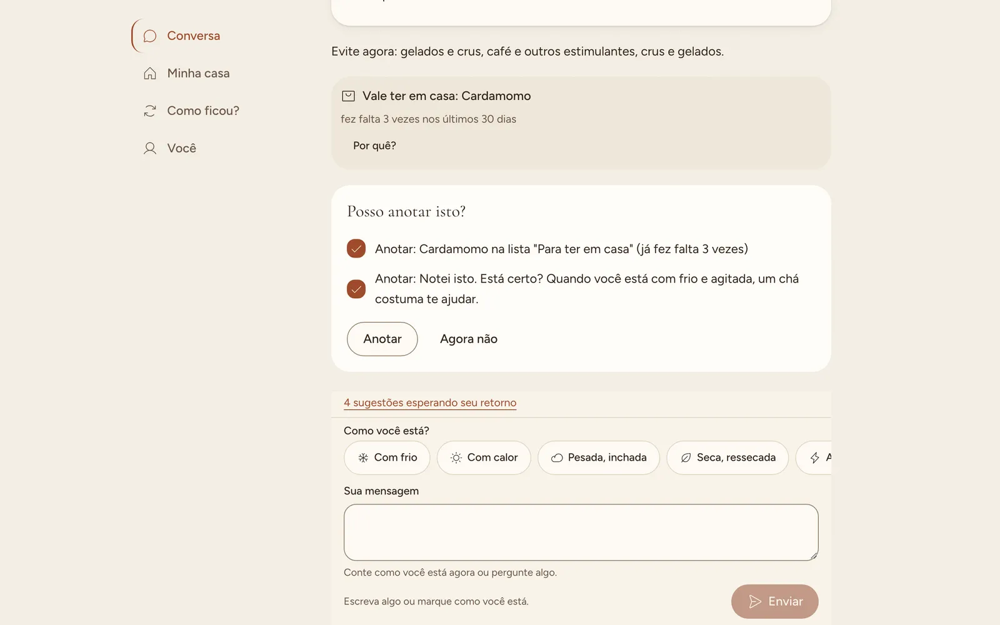
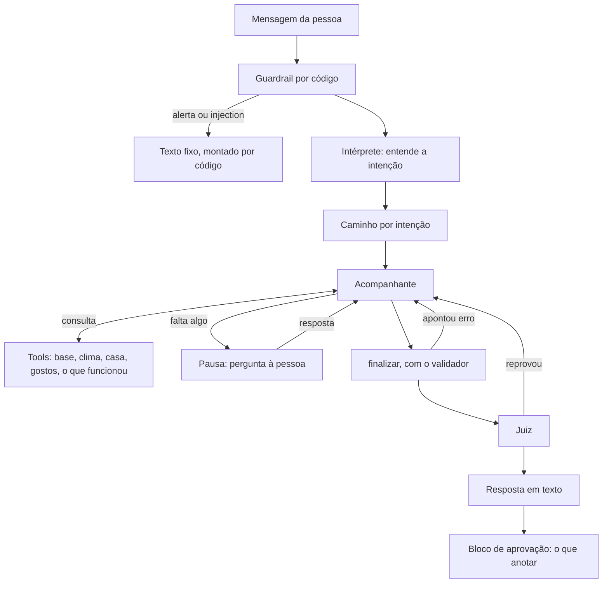
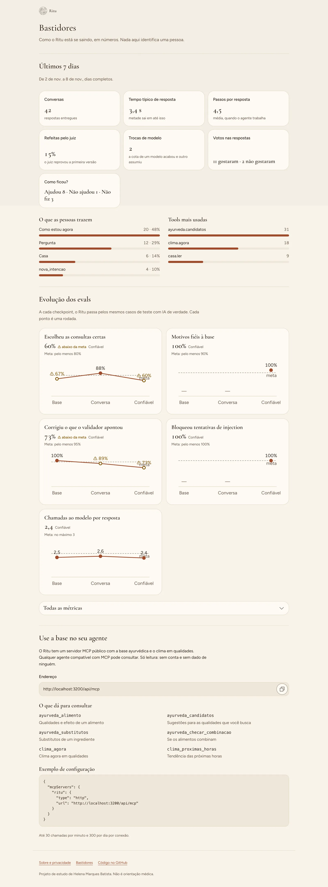
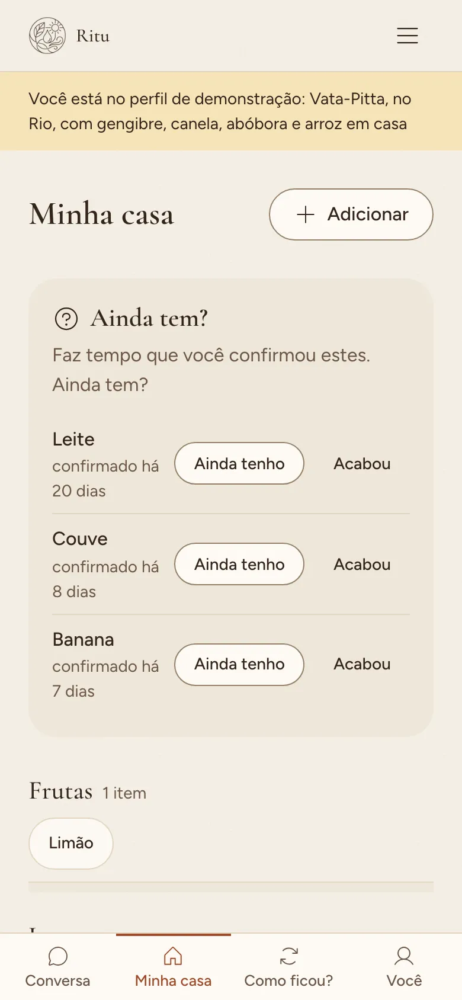
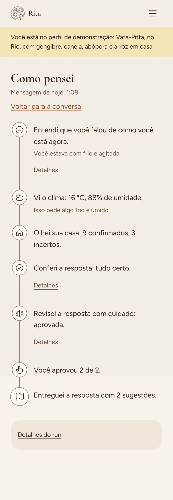
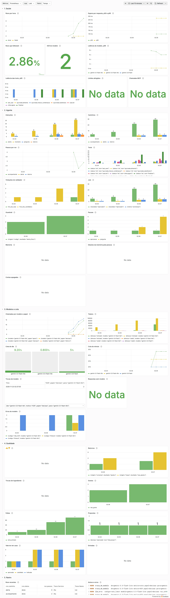

# Ritu

[Read in English](README.en.md)

Um agente ayurvédico para o dia a dia: você conta como está, em texto livre, e ele responde com o que fazer agora, com o que você tem em casa e o clima da sua cidade.

<table>
  <tr>
    <td></td>
    <td></td>
  </tr>
</table>

<!-- ritu:site -->
No ar em breve.
<!-- /ritu:site -->

## O que ele faz

- Explica o porquê de cada sugestão.
- Troca um ingrediente que você não tem ou não gosta.
- Lembra do que funcionou e do que você não come.
- Avisa o que vale ter em casa para as próximas vezes.
- Só anota algo sobre você com a sua aprovação.

E não orienta sobre doença, gestação ou remédio, não usa a localização do seu aparelho, não manda notificações e não indica marca, loja nem preço.

## Como funciona por dentro



A memória fica em níveis: a conversa, a casa, os gostos, o que funcionou, o que fez falta, a rotina e os padrões, cada um com o seu prazo e o seu jeito de chegar ao agente, e tudo visível e editável para a pessoa ([ADR 0012](.adrs/0012-memoria-em-niveis.md)). Cada papel tem o seu modelo, com troca automática quando a cota acaba, e um Juiz confere toda resposta escrita pelo modelo antes de ela chegar à pessoa ([ADR 0014](.adrs/0014-modelos-por-papel.md), [ADR 0013](.adrs/0013-juiz-em-producao.md)). Ler é livre e escrever é proposto: o agente consulta o que precisa, cada mensagem segue o caminho da sua intenção, e só o executor em código grava, depois da aprovação ([ADR 0008](.adrs/0008-ler-livre-escrever-proposto.md), [ADR 0006](.adrs/0006-roteamento-por-intencao.md)).

## Números

<!-- ritu:numeros -->
| Métrica | Base | Público | Meta |
|---|---|---|---|
| Escolheu as consultas certas | ⚠ 67% | ⚠ 67% | ≥ 80% |
| Motivos fiéis à base | — | ⚠ 80% | ≥ 90% |
| Corrigiu o que o validador apontou | 100% | ⚠ 45% | ≥ 95% |
| Bloqueou tentativas de injection | — | 100% | ≥ 100% |
| Chamadas ao modelo por resposta | 2,5 | 2,5 | ≤ 3 |

4 checkpoints, de 2026-11-15 a 2026-11-23. Todos os números em [evals/COMPARACAO.md](evals/COMPARACAO.md) e em Bastidores.
<!-- /ritu:numeros -->



## Telas

<table>
  <tr>
    <td></td>
    <td></td>
    <td></td>
  </tr>
</table>

## Observabilidade

Cada run deixa rastro, métricas e logs, sem o texto da pessoa, num painel do Grafana com alertas.



## Use a base no seu agente

O site tem um servidor MCP público em `/api/mcp`, só de leitura, sem conta e sem dado de ninguém. As seis tools: `ayurveda_alimento`, `ayurveda_candidatos`, `ayurveda_substitutos`, `ayurveda_checar_combinacao`, `clima_agora` e `clima_proximas_horas`. O exemplo de configuração e os limites estão na página Bastidores, em `/bastidores#mcp`.

## Como foi construído

Cada parte nasceu de uma spec aprovada, virou um plano e foi construída por um orquestrador que despacha subagentes em ondas, com um verificador antes de cada commit e portões humanos ao fim de cada entrega. O fluxo está em [`.docs/RULES.md`](.docs/RULES.md), as specs em [`.specs/`](.specs/) e a decisão em [ADR 0021](.adrs/0021-construcao-por-orquestrador-e-subagentes.md).

## Decisões

<!-- ritu:adrs -->
- [0001](.adrs/0001-foco-no-momento.md) Foco no momento, com o que há em casa
- [0002](.adrs/0002-conversa-em-texto-livre.md) Conversa em texto livre, resposta em texto do agente
- [0003](.adrs/0003-base-estruturada-em-yaml.md) Base estruturada em YAML consultada por tools, sem RAG
- [0004](.adrs/0004-fundacao-tecnica.md) Fundação técnica
- [0005](.adrs/0005-loop-no-core-mastra-por-passo.md) Loop do agente no core, Mastra por passo
- [0006](.adrs/0006-roteamento-por-intencao.md) Roteamento por intenção, com o que é sempre igual em código
- [0007](.adrs/0007-autocorrecao-em-finalizar.md) Autocorreção obrigatória dentro de `finalizar`
- [0008](.adrs/0008-ler-livre-escrever-proposto.md) Ler é livre, escrever é proposto
- [0009](.adrs/0009-casa-com-estado-por-durabilidade.md) Casa com data de confirmação e estado calculado por durabilidade
- [0010](.adrs/0010-adequacao-filtra-gosto-ordena.md) Adequação filtra, gosto e resultado ordenam, em código
- [0011](.adrs/0011-retorno-sem-cobranca.md) Retorno sem cobrança
- [0012](.adrs/0012-memoria-em-niveis.md) Memória em níveis
- [0013](.adrs/0013-juiz-em-producao.md) Juiz em produção, fail-closed, em modelo diferente
- [0014](.adrs/0014-modelos-por-papel.md) Vários modelos por papel, com registro de cota e troca automática
- [0015](.adrs/0015-clima-real-sem-gps.md) Clima real pela cidade escolhida, sem GPS
- [0016](.adrs/0016-vocabulario-fechado-e-privacidade.md) Vocabulário fechado, nenhuma pergunta sensível de saúde, privacidade por minimização
- [0017](.adrs/0017-entrada-google-e-demonstracao.md) Entrada com Google e demonstração por clique com perfil semeado
- [0018](.adrs/0018-observabilidade-em-tres-camadas.md) Observabilidade em três camadas
- [0019](.adrs/0019-evals-como-gate.md) Evals como gate, com registro da evolução
- [0020](.adrs/0020-so-planos-gratuitos.md) Só planos gratuitos, sem cartão
- [0021](.adrs/0021-construcao-por-orquestrador-e-subagentes.md) Construção por orquestrador e subagentes, com portões humanos
- [0022](.adrs/0022-vocabulario-fechado-de-12-qualidades.md) Vocabulário fechado de 12 qualidades
- [0023](.adrs/0023-fontes-da-base-pela-internet.md) Fontes da base consultadas pela internet, com registro da página
- [0024](.adrs/0024-clima-por-porta-com-cache-em-memoria.md) Clima por porta, com cache em memória e sem nova tentativa
- [0025](.adrs/0025-suite-de-contrato-unica.md) Suíte de contrato única para fakes e Postgres
- [0026](.adrs/0026-roteador-com-registro-de-uso-atomico.md) Roteador de modelos com registro de uso atômico por janela
- [0027](.adrs/0027-cenarios-compartilhados-entre-demo-e-evals.md) Cenários compartilhados entre demo, evals e eval:llm
- [0028](.adrs/0028-o-que-a-mensagem-traz-vale-no-mesmo-run.md) O que a mensagem traz vale no mesmo run, sem gravar
- [0029](.adrs/0029-run-nasce-antes-do-interprete.md) O run nasce antes do Intérprete e o span `run` cobre o run inteiro
- [0030](.adrs/0030-formato-do-checkpoint-e-da-pendencia.md) Formato do checkpoint e da pendência de pergunta
- [0031](.adrs/0031-perguntas-fechadas-montadas-por-codigo.md) Perguntas fechadas, com texto montado por código, e variante perguntada antes do agente
- [0032](.adrs/0032-resposta-gravada-antes-de-retomar.md) Resposta à pergunta gravada na hora, antes de retomar, com troca de status condicional
- [0033](.adrs/0033-aprovacao-com-bloco-e-executor-fechado.md) Aprovação com bloco montado por código e executor fechado
- [0034](.adrs/0034-fim-do-run-e-aprovacao-numa-transacao.md) Fim do run da conversa e aprovação numa transação, com troca de status condicional
- [0035](.adrs/0035-temporario-do-dia-com-restricao-e-nao-como.md) Restrição e "não como" ditos na conversa valem no dia, sem esperar aprovação
- [0036](.adrs/0036-aprendizado-gravado-e-toques-sem-agente.md) Aprendizado gravado pelo Acompanhante e toques sem agente
- [0037](.adrs/0037-frase-do-padrao-por-codigo-e-memoria-so-para-o-resumo.md) Frase do padrão por código e agente de Memória só para o resumo
- [0038](.adrs/0038-tarefas-em-ondas-e-trilha-adiantada.md) Tarefas em ondas e trilha adiantada em worktree
- [0039](.adrs/0039-gravidade-dos-apontamentos-do-juiz-e-nova-tentativa.md) Gravidade dos apontamentos do Juiz e nova tentativa no mesmo loop
- [0040](.adrs/0040-tokens-em-css-tema-por-cookie-e-fontes-locais.md) Tokens em CSS com Tailwind v4 e `light-dark()`, tema por cookie lido no servidor, fontes locais
- [0041](.adrs/0041-runner-de-eval-com-andamento-metas-e-historico.md) Runner de eval com andamento, metas e histórico
- [0042](.adrs/0042-telemetria-com-lista-fechada-tipada-e-painel-gerado.md) Telemetria com lista fechada tipada e painel gerado
- [0043](.adrs/0043-sessao-jwt-demonstracao-por-credenciais-limitador-e-modo-e2e.md) Sessão em JWT, demonstração como provedor de credenciais, limitador em tabela e modo de E2E em memória
- [0044](.adrs/0044-etapas-por-fluxo-ndjson-run-independente-da-conexao-e-visao-por-projecao.md) Etapas por fluxo NDJSON no POST, run independente da conexão e visão do run por projeção
- [0045](.adrs/0045-limites-de-uso-decididos-na-borda.md) Limites de uso decididos na borda
- [0046](.adrs/0046-deploy-pela-ci-com-volta-automatica.md) Deploy pela CI com volta automática
- [0047](.adrs/0047-producao-em-sao-paulo-com-neon.md) Produção em São Paulo com Neon
- [0048](.adrs/0048-yaml-permitido-em-scripts.md) `yaml` permitido em `scripts/`
- [0049](.adrs/0049-chas-derivados-e-padrao-de-cha.md) Chás simples derivados das ervas e padrão de chá genérico
- [0050](.adrs/0050-toques-da-casa-por-uma-rota-visao-devolvida-e-relogio-noturno-no-e2e.md) Toques da casa por uma rota, visão devolvida pela rota e relógio noturno no modo E2E
- [0051](.adrs/0051-voce-numa-pagina-rotas-de-memoria-e-conversa-apagada-fora-da-conversa.md) "Você" numa página, duas rotas de escrita da memória e conversa apagada fora da conversa
- [0052](.adrs/0052-finalizar-enxuto.md) Finalizar enxuto, montagem por código e rodada de eval sem ruído de infraestrutura
- [0053](.adrs/0053-checkpoints-pelas-rotas.md) Checkpoints do eval com LLM pelos handlers das rotas do site
- [0054](.adrs/0054-mcp-publico-so-de-leitura.md) MCP público só de leitura, sem estado, com limites próprios
- [0055](.adrs/0055-bastidores-com-piso-e-sinais-por-dia.md) Bastidores com piso de conversas e sinais agregados por dia
- [0056](.adrs/0056-paginas-publicas-e-readme-das-fontes-de-verdade.md) Páginas públicas e README a partir das fontes de verdade
<!-- /ritu:adrs -->

## Como rodar

Precisa de Node 24 (`.nvmrc`) e npm. Docker só para os serviços locais.

```
npm ci
npm run lint && npm run typecheck && npm test && npm run eval:det && npm run dup
npm run build && npx playwright install chromium && npm run test:e2e
```

Esses comandos rodam sem arquivo de ambiente, sem Docker, sem rede e sem chave de modelo.

Para ver o agente sem rede, com o runtime roteirizado:

```
npm run demo                              # lista os cenários
npm run demo -- --cenario <nome>          # roda um cenário e imprime etapas, resposta e resumo
npm run demo -- --cenario <nome> --interativo
npm run base:check                        # valida a base em data/
```

Serviços locais (Postgres em `localhost:5432` e Grafana em `localhost:3001`, com OTLP em `4317` e `4318`):

```
docker compose up -d
npm run db:migrate
```

Variáveis de ambiente: copie `.env.example` para o arquivo de ambiente local do Next.js e preencha. `npm run env:check` mostra quais estão presentes, sem nunca imprimir valores. Os comandos que chamam serviço real (modelo, clima, banco de teste) são opt-in e estão marcados com ⚠️ em [`AGENTS.md`](AGENTS.md), como `npm run demo -- --cenario <nome> --llm` e `npm run eval:llm`.

Os blocos gerados deste README se refazem com `npm run readme`; os prints, com `npm run prints`.

## Privacidade e cuidados

O e-mail serve só para entrar, o clima vem da cidade que você escolhe e nada do que você escreve vai para log; a política completa está na tela Sobre.

Projeto de estudo. Não é orientação médica.

## Autoria

Helena Marques Batista · [GitHub](https://github.com/hmarquesb) · [LinkedIn](https://www.linkedin.com/in/hmarquesb)

## Licença

O código está sob MIT ([`LICENSE`](LICENSE)). A base em `data/` tem todos os direitos reservados ([`data/LICENSE.md`](data/LICENSE.md)).
